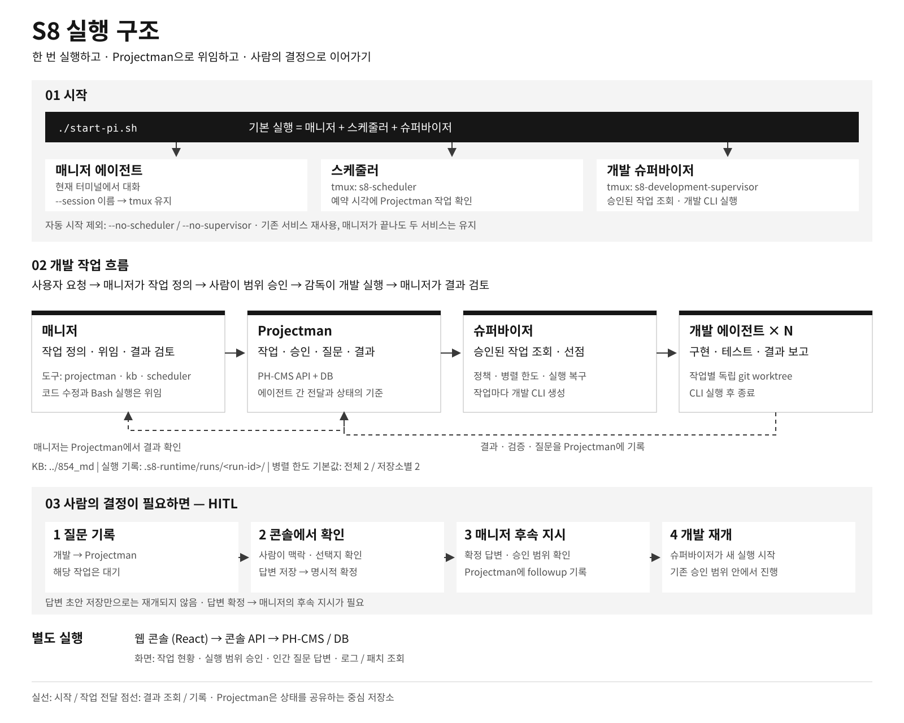

# S8 Agent — Projectman 작업 관리

## 실행 구조 한눈에 보기



[크게 보기](docs/images/s8-runtime.png) · [SVG 원본](docs/images/s8-runtime.svg)

## 실행 진입점

에이전트 실행 스크립트는 역할마다 하나씩 있고, 에이전트 하나를 이 터미널에서 실행한다. tmux·서비스는 다루지 않는다.

```bash
./start-general-agent.sh                       # 범용 에이전트: 실행 위치에서 파일·셸·코드 수정
./start-general-agent.sh --cwd /path/to/work
./start-manager-agent.sh                       # Projectman 매니저: KB 저장소에서 프로젝트·작업 생성·갱신
./start-manager-agent.sh --telegram            # Telegram 연결
./start-worker-agent.sh --uid <UID>            # Projectman 워커: 실행 위치 저장소에서 UID 작업 claim·수행·보고
./start-general-agent.sh --print --model <모델> # 비대화형 실행
```

모드별 도구·확장·시스템 지침은 `agents/<모드>/profile.json`에 있다. 범용 모드는 `.env`를 읽지 않고, 매니저 모드는 `.env`를 읽어 Projectman 연결 설정을 사용한다. `/restart`로 종료하면 최근 대화로 다시 시작한다.

워커 모드는 task·subtask UID 하나를 직접 claim하고 결과를 보고한다. `--uid` 없이 실행하면 "uid xxx 의 업무를 수행해라"처럼 대화로 지시한다. claim·보고 요청은 `.s8-runtime/worker-claims/`와 `.s8-runtime/runs/<runId>/outbox.json`에 먼저 기록해 재시도해도 한 번만 반영된다. 보고는 Projectman에 저장되고 매니저 수신함과 Telegram으로 전달된다(실패분은 매니저가 15초마다 재전달). claim 전과 보고 후에는 파일·명령 도구를 막고, bash에는 토큰·비밀번호 환경변수를 넘기지 않는다. 승인(사람의 계획 확인)된 ready 작업만 claim한다.

tmux 런타임(매니저 창·스케줄러·작업 워커 창)은 `s8.sh`가 담당한다. 터미널에서 실행하면 `project` / `local` 모드를 선택하고, 자동화와 비대화형 실행은 `--mode`를 명시한다. Pi 창은 내부에서 `start-manager-agent.sh`(project) 또는 `start-general-agent.sh`(local)를 실행한다.

```bash
./s8.sh --mode project              # Projectman 관리·개발 위임
./s8.sh --mode local                # 현재 디렉터리에서 범용 작업·직접 개발
./s8.sh --mode local --cwd /path/to/work
./s8.sh --mode local --telegram take # 이 세션으로 Telegram 연결 이전
./s8.sh --mode local --telegram off  # 이 세션 연결 비활성
./s8.sh work <UID>                   # 승인된 작업의 워커를 s8-workers:<UID> 창에 실행
./s8.sh service scheduler            # 예약 데몬 단독 실행
```

로컬 모드는 기본 `s8-local` 세션을 사용하고, KB·Projectman 설정과 프로젝트 서비스 없이 실행한다. 첫 비대화형 실행의 Telegram 연결은 꺼져 있다. 터미널 실행에서는 현재 연결 세션을 보여주고 **현재 연결 유지 / 여기로 가져오기**를 선택한다. 기본 선택은 현재 연결 유지이며, 명시적인 `--telegram take/off`가 있으면 선택을 생략한다. 실행할 때마다 모든 tmux 세션을 종료하고, 프로젝트 모드는 `s8-main` 세션과 서비스를 새로 만든다. 인증은 공유하지만 로컬 대화 이력은 세션·작업 디렉터리별로 분리한다. `--manager`는 `--mode project`의 별칭이다. `--help`, `--sessions`, `work`, `service`는 모드 선택을 생략한다. 패키지 관리 명령·`--version`·`--print`는 `start-*-agent.sh`로 실행한다.

아래 기존 운영 안내의 서비스·Telegram 기본 동작은 `project` 모드 기준이다.

`./s8.sh --mode project`는 범용 매니저와 스케줄러를 함께 시작한다. 매니저는 일반 대화·파일·Bash 작업을 직접 처리하고, 개발 요청은 Projectman 작업으로 만들어 사람이 계획을 확정하면 `run_worker`로 워커에 맡긴다.

- 매니저: 일반 대화·질문·글쓰기·문서 편집·파일 검색·로그 조회·일반 Bash 작업과 개발 위임·결과 검토. 요청 목적에 따라 처리 경로를 선택하므로 별도 모드 전환은 필요 없다.
- 매니저 도구: `projectman`, `kb`, `scheduler`, `run_worker`, `read`, `bash`, `edit`, `write`, `grep`, `find`, `ls`. TUI와 Telegram 매니저 세션에 동일하게 적용한다. 개발 목적의 코드 조사·수정·빌드·테스트는 Projectman에 위임한다. 범용 Bash 권한을 제공하므로 이 구분은 시스템 지침에 따른 동작 규칙이며 실행 격리 경계가 아니다.
- KB: Markdown 검색·조회와 정책 확인, 버전 충돌 검사를 거친 문서 쓰기·삭제. 변경은 대화형 확인이 필요하다.
- Scheduler: Projectman 예약만 관리한다. 임의 셸 예약은 관리 도구에서 변경할 수 없다.
- 착수 전: `todo`를 **일 시작 전**으로 표시한다. 매니저가 원문·코드·지침·요구 충돌·누락·허용 범위·검증 계획을 검토하고 작은 의문도 사용자에게 확인한다. 확정 내용을 `delegate`한 뒤 `preflight_review`로 work의 `s8Preflight`에 기록한다. S8 콘솔은 이 기록이 현재 작업·spec과 일치해야 승인·실행을 허용한다. 내용이나 spec이 변경되면 재검토한다. 기존 승인 작업도 검토 기록이 없으면 실행되지 않는다.
- 개발: 사람이 계획을 확정한 ready 작업을 매니저가 `run_worker`로, 또는 사용자가 `./s8.sh work <UID>`로 실행한다. 실행기는 작업별 독립 git worktree(`.s8-runtime/worktrees/<UID>`)를 만들고 선행 작업 패치를 적용한 뒤, `s8-workers:<UID>` 창에서 `start-worker-agent.sh`를 띄운다. 워커가 claim·구현·검증·보고를 직접 한다. 동시 실행 수 제한은 없다. 이미 claim한 작업을 다시 실행하면 같은 worktree에서 이어간다.
- 개발 중 판단: 최종 승인된 작업의 구현 선택과 일반 테스트 실패는 워커가 스스로 해결한다. work당 토큰·시간·명령·실행 횟수 예산은 없다. 실제 실패·취소는 결과와 기록을 보존한다.
- 완료: 워커가 결과를 보고하면 review로 저장하고 매니저에게 보고를 전달한다. 사용자는 Telegram으로 요약과 work 링크를 받는다. 매니저 검토 후 사용자가 화면에서 선택적으로 검토의견을 적고 완료를 제출한다. 원본은 done으로 확정되며 매니저가 의견을 보고 추가 조치 없음·새 work 작성·질문을 판단한다. 새 work는 별도 실행 승인을 받는다.
- 기록: `.s8-runtime/runs/<run-id>/`의 전달 프롬프트·공개 응답·도구 이벤트·결과·검증·패치와 Projectman 작업 이력을 연결한다. 모델 내부 추론과 인증정보는 기록 대상이 아니다.

역할별 기준은 [관리 지침](agents/manager/SYSTEM.md)과 [워커 지침](agents/worker/SYSTEM.md)에 있다. 실행 방법은 아래 안내를, 화면·프록시 구성은 [프런트엔드 README](frontend/README.md)를 따른다.

`854_md` 지식베이스를 사용하는 개인용 AI 작업 오케스트레이터와 운영 콘솔이다. 지식과 에이전트 설정을 각각 `854_md`, `s8-agent` 저장소로 분리한다.

기본 배치는 두 저장소가 형제 디렉터리인 구조다.

```text
dev_854/
├── 854_md/       # 지식베이스
├── s8-agent/     # 에이전트 설정·실행 코드
└── ph-cms/       # Projectman 사용에 필요한 API·MCP 서버
```

## 구성

- 재사용 Pi 설정과 npm 패키지: `pi/`
- Pi 장비별 런타임: `.pi-runtime/`
- 에이전트 실행 진입점: `start-general-agent.sh`, `start-manager-agent.sh`, `start-worker-agent.sh` (tmux 런타임: `s8.sh`)
- 작업 워커 실행: `s8.sh work <UID>`, 매니저 `run_worker`
- 역할 지침·프로필: `agents/general/`, `agents/manager/`, `agents/worker/`
- 비공개 로컬 상태: `.s8-runtime/`
- 비인증 Telegram ID·알림 대상 설정: `s8-config.yml` (예시: `s8-config.example.yml`)
- 웹 콘솔·업로드·xterm.js 터미널: `frontend/`
- 호스트 PTY·tmux 웹 터미널 게이트웨이: `apps/terminal-gateway/`
- Telegram 명령·알림: `apps/telegram-gateway/`
- 예약 작업 실행 진입점: `s8.sh service scheduler`
- 예약 CRUD·실행·배치 제어: `pi/extensions/scheduler.ts`, `pi/lib/scheduler/`
- 지식베이스·업로드 API: `apps/kb-browser/`
- MCP 허브: `apps/mcp-hub/`
- Nginx와 Compose: `infra/nginx/`

## 코드 위치와 역할

`pi/bin`은 실행 명령, `pi/extensions`는 에이전트 도구 등록, `pi/lib`는 기능 구현이다. 기능 구현은 아래 역할별 폴더에 두며 파일명에서 반복되는 접두어를 줄였다.

```text
pi/
├── bin/                     # CLI 진입점과 검증 실행 스크립트
├── extensions/              # Pi 도구·이벤트 연결
├── lib/
│   ├── config/              # s8-config.yml 읽기·검증
│   ├── agent/               # 모드 프로필·실행기, 워커 claim·보고, 작업 실행(worktree·창)
│   ├── development/         # worktree·패치, 보고 outbox 전달
│   ├── manager/             # 매니저 도구 설정, KB 접근, 보고 수신함
│   ├── projectman/          # PH-CMS API, 승인·사전 검토, 웹 콘솔·인증·이력
│   ├── runtime/             # Pi·tmux 세션, 서비스 기동·재시작, 모델 로딩
│   ├── scheduler/           # 예약 저장·제어·실행
│   ├── telegram/            # 알림 전송과 현재 연결 상태
│   └── storage/             # 민감 값 필터링·원자적 JSON 기록
└── test/
    ├── *.test.mjs           # 기능별 회귀 테스트
    ├── helpers/             # SDK 세션·브라우저 테스트 어댑터
    └── manual/              # 명시적으로 실행하는 실제 모델 역할 평가
```

| 찾으려는 기능 | 구현 위치 | 실행·연결 진입점 |
| --- | --- | --- |
| 에이전트 모드·실행 인자·재시작 | [agent/launch.mjs](pi/lib/agent/launch.mjs), [agent/profile.mjs](pi/lib/agent/profile.mjs) | `start-*-agent.sh` → `pi/bin/agent.mjs` |
| 워커 claim·보고·도구 차단 | [agent/worker-run.mjs](pi/lib/agent/worker-run.mjs), [worker 확장](pi/extensions/worker.ts) | `start-worker-agent.sh` |
| 작업 실행(worktree·선행 패치·워커 창) | [agent/work.mjs](pi/lib/agent/work.mjs), [development/workspace.mjs](pi/lib/development/workspace.mjs) | `s8.sh work <UID>`, 매니저 `run_worker` |
| 보고 전달(Projectman·매니저·Telegram) | [development/outbox.mjs](pi/lib/development/outbox.mjs) | 워커 보고, 매니저 polling |
| 완료보고·사용자 검토의견 수신 | [manager/inbox.mjs](pi/lib/manager/inbox.mjs), [manager 확장](pi/extensions/manager.ts) | 매니저 시작·기존 polling |
| Projectman API·콘솔 | [projectman/client.ts](pi/lib/projectman/client.ts), [projectman/console.mjs](pi/lib/projectman/console.mjs) | `pi/extensions/projectman.ts`, `pi/bin/projectman-console.mjs` |
| Pi 세션·서비스 시작·재시작 | [runtime/](pi/lib/runtime/) | `s8.sh` → `pi/bin/s8.mjs` |
| 설정·알림 | [config/s8-config.mjs](pi/lib/config/s8-config.mjs), [telegram/notify.mjs](pi/lib/telegram/notify.mjs) | `pi/bin/s8-config.mjs`, 보고 outbox |
| 예약 실행 | [scheduler/](pi/lib/scheduler/) | `s8.sh service scheduler`, `pi/extensions/scheduler.ts` |

개발 흐름을 따라 읽을 때는 `agent/work → extensions/worker → agent/worker-run → development/outbox` 순서로 본다. 결과는 outbox에서 Projectman API, manager/inbox, telegram/notify로 전달된다. 워커 보고와 사람의 최종 완료는 별도 단계다.

회귀 테스트는 저장소 루트에서 실행한다.

```bash
node --test pi/test/*.test.mjs apps/telegram-gateway/gateway.test.mjs
npm run test:run --prefix frontend
npm run build --prefix frontend
```

실제 모델을 사용하는 선택적 역할 평가는 `node pi/test/manual/evaluate-roles.mjs`로 실행한다. 자동 회귀 테스트에는 포함하지 않으며 모델 인증과 사용량이 발생한다. 워커 claim·보고·실행은 `pi/test/worker-mode.test.mjs`가 검증한다.

### 결과 검토와 완료

개발 완료 알림의 work 링크에서 결과와 매니저 검토를 확인한다. 선택 입력인 **검토의견**에 수정·보완 내용을 적고 **검토의견 제출 · 작업 완료**를 누르면 원본을 done으로 처리한다. 의견 없이 완료할 수도 있다. 의견은 기존 PH-CMS 완료 work_log에 저장되며, 매니저가 접속하면 결과와 함께 전달된다.

매니저는 의견에 따라 추가 조치 없이 종료하거나, 불명확한 내용을 질문하거나, 같은 프로젝트에 새 work 계획을 작성한다. 새 work는 원본 UID와 검토의견 참조를 기록하고 완료된 원본을 선행 작업으로 지정해 기존 결과 패치를 이어받는다. 별도 추가작업 버튼·재작업 상태·자동 실행은 없다. 새 계획은 사용자가 실행 승인한다.

완료 요청 전에 `.s8-runtime/completion-reviews/`에 전달 기록을 보존한다. 완료 응답이 유실되거나 매니저 수신함 기록에 실패하면, 매니저의 기존 polling이 요청 ID와 내용 지문이 일치하는 서버 완료 이력을 확인한 후 전달을 복구한다. 화면 재시도는 같은 요청 ID와 의견을 사용한다. 수신함 전달은 장애 시 재전달될 수 있어 매니저가 같은 참조의 후속 work를 먼저 확인한다. PH-CMS 소스나 DB 스키마는 변경하지 않는다.

## 빠른 시작

요구 사항:

- Node.js 22.19.0 이상과 npm
- 기본 통합 실행·지속 실행·웹 터미널에는 tmux
- 예약 쉘 스크립트에는 Bash. Windows에서는 Git Bash 등으로 제공
- 개발 작업의 테스트·빌드와 웹 인프라에는 Docker
- Projectman에는 실행 중인 PH-CMS와 DB, 에이전트 서비스 키
- 다른 장치에 웹 콘솔을 노출할 때는 Tailscale과 Nginx

```bash
cd /path/to/s8-agent
npm ci --ignore-scripts --prefix pi
./s8.sh
tmux attach-session -t s8-main
```

`s8.sh`는 백그라운드 실행 후 세션과 창 목록만 출력한다. Pi 창이 열리면 `/login`으로 이 장비의 모델 인증을 설정한다. 인증정보와 세션은 `.pi-runtime/`에 저장되며 Git과 에이전트 도구의 접근 대상에서 제외한다. 공유 설정의 원본은 `pi/settings.json`이며 런타임에서 이 파일을 링크로 참조한다. 관리 세션의 provider/model은 `pi/settings.json`을 기준으로 하며 Pi에서 변경할 수 있다. 워커도 같은 `.pi-runtime/` 인증을 사용한다.

이후 실행:

```bash
./s8.sh
./s8.sh --continue
./s8.sh --no-telegram           # Telegram 없이 단독 실행
./s8.sh --session work          # 모든 세션 종료 후 work 세션 시작
./s8.sh --no-scheduler           # 스케줄러 자동 시작 제외(매니저만 실행)
```

Pi와 서비스는 기본 `s8-main` 세션의 `pi`·`scheduler` 창에 유지된다. 작업 워커는 `s8-workers` 세션의 UID 창에서 실행된다. `shell` 창에서 호스트 명령을 실행한다. 스크립트는 자동 접속하지 않으며 웹 터미널에서 세션을 선택하거나 `tmux attach-session -t s8-main`으로 접속한다. PH-CMS는 별도로 실행한다.

실행 스크립트는 시작할 때 저장소 루트의 `.env`를 로드한다(범용 모드는 제외). 처음 설정하는 장비에서만 예시를 복사하고, 이미 있는 설정은 덮어쓰지 않는다.

```bash
cp -n .env.example .env
```

```dotenv
S8_KB_ROOT=/home/user/kb_root
PHCMS_API_URL=http://127.0.0.1:8000/api/v2
# PHCMS_ACCESS_TOKEN에는 직접 발급한 에이전트 서비스 키를 설정한다.
```

`S8_KB_ROOT`에는 실제 지식베이스의 절대 경로를 지정한다. `.env`는 Git에 포함되지 않는다.

## 실행 스크립트

실행 스크립트는 경로를 스크립트 위치 기준으로 계산하므로 다른 디렉터리에서도 실행할 수 있다.

| 스크립트 | 역할 | 실행 예 |
| --- | --- | --- |
| `s8.sh` | 모든 tmux 세션 종료 후 선택한 모드로 시작 | `./s8.sh --session manager` |
| `start-infra.sh` | 기존 `s8-infra` 창과 Nginx·KB Browser 컨테이너를 교체하고 frontend·콘솔 API·터미널 게이트웨이를 재시작 (PHCMS 명령은 선택 설정) | `./start-infra.sh` |
| `s8.sh work <UID>` | 승인된 작업의 워커를 `s8-workers:<UID>` 창에 실행 | `./s8.sh work abc123` |
| `s8.sh finish <UID> --run-id <UUID> --confirm-stopped` | 멈춘 실행을 실패로 보고해 마무리(claim 기록이 없어도 가능, Projectman 화면의 `실패로 마무리`와 동일, 절차는 OPERATIONS.md) | `./s8.sh finish abc123 --run-id … --confirm-stopped` |
| `s8.sh service scheduler` | 통합 실행에서 사용하는 예약 데몬 진입점. 단독 실행도 지원 | `./s8.sh service scheduler` |

- `s8.sh`로 런타임을 시작하면 현재 tmux 서버의 모든 세션을 `kill-server`로 종료한 뒤 선택한 세션을 새로 만든다. 다른 S8 세션, 워커, 인프라, 개인 tmux 세션도 종료된다. 기존 tmux 안에서 호출해도 분리된 제어 프로세스가 재시작을 완료한다. `--session 이름`으로 새 세션을 선택하며 자동 접속 없이 창 목록을 출력한다. 기존 창에 저장된 실행 옵션은 초기화되므로 필요한 옵션을 다시 지정한다. 대화 파일은 디스크에 남으며 `--continue`로 이어갈 수 있다. `--sessions`는 조회만 한다. `work`, `service`, 도움말은 전체 세션 종료를 수행하지 않는다. 런타임을 다시 시작하면 실행 중인 워커 창도 종료되므로, 진행 중인 작업은 `./s8.sh work <UID>`로 이어서 실행한다.
- 기본 실행은 `s8-main` 세션에 `shell`·`pi`·`scheduler` 창을 준비한다. `--session manager`를 지정하면 `s8-manager`를 사용한다. tmux 밖에서 살아 있는 서비스는 중복 실행하지 않는다. 재시작 시 종료된 PID의 남은 서비스 잠금만 정리하며 살아 있는 프로세스의 잠금은 보존한다. 인프라 세션이 필요하면 `./start-infra.sh`로 다시 시작한다.
- `--no-scheduler`는 해당 호출의 자동 시작만 제외한다. 이미 실행 중인 공유 서비스를 종료하지 않는다. 옵션은 `--session manager`와 함께 사용할 수 있다. 제외한 공유 서비스는 재시작하지 않는다.
- 도움말·버전·세션 목록·패키지 관리 명령과 일회성 `--print` 실행은 서비스를 시작하지 않는다. 서비스 시작에 실패하면 오류를 표시하며, 해당 제외 옵션으로 매니저를 따로 실행할 수 있다.
- 재시작 제어는 터미널과 분리된 프로세스에서 끝까지 수행한다. 현재 Pi에서 s8.sh를 호출해 호출자가 종료되어도 새 Pi와 Telegram 연결을 올린다. 실행 결과는 `.s8-runtime/runtime-restarts/`에 저장한다.
- 이전 방식의 Pi 세션이 같은 이름을 사용 중이면 다른 `--session 이름`으로 시작한다. 기존 Pi를 자동 종료하거나 대화 기록을 이관하지 않는다.
- 자동 시작한 서비스를 종료하려면 `tmux attach -t s8-main`으로 접속하고 `Ctrl+B`, `W`로 `scheduler` 창을 선택한 뒤 `Ctrl+C`를 누른다. 종료된 창은 로그 확인을 위해 남으며 다음 시작 시 재사용한다. 강제 종료 후 잠금이 남으면 실제 프로세스 종료를 확인한 뒤 정리한다.
- 상시 개발 워커는 없다. 작업마다 `s8-workers:<UID>` 창에 워커를 띄우며, 보고 후 창은 직접 닫는다.
- 전경 프로세스는 `Ctrl+C`로 종료한다. tmux에서는 `Ctrl+B`, `D`로 접속만 해제하면 실행이 유지된다.

## Projectman 콘솔 실행

PH-CMS 서버와 DB를 먼저 실행한다. 신규 채널은 PH-CMS 루트에서 `pnpm db:setup:projectman <ownerUid> [agentUid]`로 초기화한다. S8의 `.env`에 API 주소와 에이전트 서비스 키를 직접 설정한 뒤 확인한다.

```bash
# 매니저와 스케줄러 통합 시작
./s8.sh --session manager

# start-infra.sh를 사용하지 않는 경우 콘솔 API를 별도 터미널에서 유지
node pi/bin/projectman-console.mjs
```

프런트엔드는 별도 터미널에서 실행한다.

```bash
npm ci --prefix frontend
npm --prefix frontend run build
npm --prefix frontend run preview -- --host 127.0.0.1 --port 4178 --strictPort
```

`http://127.0.0.1:4178/s8/`에서 PH-CMS **사용자 계정**으로 로그인한다. 콘솔 API는 기본 `127.0.0.1:8791`에서 실행하며, 사용자 결정에 에이전트 서비스 키를 사용하지 않는다. 로그인·토큰 갱신은 콘솔 서버의 PH-CMS client-sdk가 처리한다. 15분짜리 액세스 토큰이 만료되면 HttpOnly 리프레시 쿠키로 자동 갱신하며, 갱신 토큰은 마지막 발급부터 7일 유효하다. 다른 PH-CMS 주소를 사용하면 콘솔 프로세스에도 기존 `PHCMS_API_URL`을 제공한다.

- 워크스페이스 버튼 한 번으로 소속 프로젝트 전체와 승인 전·실행 대기·실행 중·대기·결과 검토·완료·취소 보드를 확인한다.
- 하위 작업은 해당 프로젝트에 함께 표시한다. 프로젝트가 비어 있어도 목록에 남는다.
- 인간 결정 대기 카드를 눌러 미해결 질문만 모아보고, 작업 카드를 눌러 원래 요청·이유·영향·실행 범위와 기록을 확인한다.
- 답변 저장은 초안이다. **답변 확정 · 재개 요청** 후 매니저가 후속 지시를 기록해야 새 개발 실행이 시작된다.
- 개발 산출물은 별도 worktree와 검토용 패치로 남는다. 원래 브랜치에 자동 병합·커밋하지 않는다.
- 화면은 흰색·검은색·중성 회색과 IBM Plex Sans KR을 사용하는 밝은 테마로 통일한다. 모바일에서는 상태 보드를 가로로 스크롤한다.

첫 작업에서는 매니저와 워크스페이스·프로젝트를 등록하고 콘솔에서 개발 범위를 승인한다. 실행 명령은 이 문서의 콘솔 실행 절을, 화면·프록시는 [프런트엔드 README](frontend/README.md)를 따른다. 기존 예약·MCP·요청 등록의 상세 절차는 [운영 문서](OPERATIONS.md)를 참고한다.

## 웹 터미널

- `/s8/terminal`은 기본으로 호스트 셸에 접속한다. 세션 선택에서 같은 호스트 사용자·tmux 서버의 PHCMS, S8 스케줄러·작업 워커, Pi 등 모든 실행 세션을 제어한다. Pi 관리 표시가 없어도 접속할 수 있으며, tmux 밖의 서비스는 호스트 셸에서 운영 명령으로 제어한다.
- `./start-infra.sh`는 저장소 루트 `.env`를 Compose에 명시 전달하고, 실행할 때마다 기존 `s8-infra` 창 전체(PHCMS 포함)와 Nginx·KB Browser 컨테이너를 교체한 뒤 frontend·Projectman 콘솔 API·터미널 게이트웨이를 재시작한다. 사전에 `pi`, `frontend`, `apps/terminal-gateway`의 npm 의존성을 설치한다. PHCMS 실행은 선택 사항이며 `.env`의 `PHCMS_START_COMMAND`에 명령을 지정하면 새 `phcms` 창에서 실행한다. 기본값은 미설정으로, PHCMS 창은 비워 둔다. 실행 중인 창의 프로세스는 종료되므로 필요한 작업은 먼저 저장한다. 웹 터미널 세션 목록에서 `s8-infra`를 선택해 접속한다. `NGINX_BIND_IP`가 셸 환경변수나 `.env`에 없으면 localhost(`127.0.0.1`)에만 바인딩한다.
- `./s8.sh --sessions`로 목록, `./s8.sh --session main`으로 생성·재시작한 뒤 창 목록을 출력한다. 접속은 웹 터미널이나 `tmux attach -t s8-main`을 사용한다.
- `./s8.sh --mode project --session main --telegram take`는 모든 tmux 세션을 종료한 뒤 Pi와 공유 서비스를 새로 시작하고 Telegram을 연결한다. `--telegram`은 `--telegram take`, `--no-telegram`은 `--telegram off`의 호환 별칭이다. 연결을 끈 세션에서도 TUI의 `/telegram`으로 나중에 연결할 수 있다.
- backend 설치·실행, Tailscale 전용 노출 및 복구는 [`apps/terminal-gateway/README.md`](apps/terminal-gateway/README.md)를 따른다.
- 별도 웹 인증은 없으므로 Tailscale IP와 ACL을 접근 권한 경계로 유지한다. 셸은 호스트 사용자 권한으로 실행되며 Pi의 파일 보호 확장은 직접 터미널 입력을 제한하지 않는다.
- 글자 크기·전체화면·모바일 붙여넣기를 지원한다. Nerd Font 아이콘은 웹폰트로 제공하고 한글·다른 언어는 클라이언트의 시스템 폰트로 대체한다.
- 기본 화면은 실제 Projectman 작업·인간 결정·개발 실행 기록을 조회한다. PH-CMS 사용자 로그인이 필요하며 서비스 키는 브라우저에 전달하지 않는다.

## Telegram 연동 (Pi 터미널 세션 공유)

기존 `~/.pi/agent/telegram.json`은 자동으로 읽거나 복사하지 않는다. 봇 토큰은 기존 `.env` 또는 실행 환경의 `TELEGRAM_BOT_TOKEN`에 유지하고, 사용자·그룹 ID와 예약 알림 대상은 저장소 루트 `s8-config.yml`에 설정한다. 서비스 키나 봇 토큰을 YAML에 넣지 않는다.

```yaml
telegram:
    allowedUserIds:
        - "123456789"
    allowedGroupIds:
        - "-1001234567890"
    scheduleChatId: "123456789"
```

- 예시: [`s8-config.example.yml`](s8-config.example.yml). 실제 `s8-config.yml`은 Git에서 제외하지만 에이전트가 비인증 설정으로 조회·수정할 수 있다.
- 예약 알림 대상은 허용 목록에 포함된 개인/그룹 chat ID를 명시한다. 대상 미지정은 `null`이며 임의 사용자에게 자동 전송하지 않는다.
- 파일이 있으면 모든 ID 설정은 파일만 사용한다. 누락된 목록은 빈 목록, 누락된 알림 대상은 `null`이며 기존 환경변수와 합치지 않는다. 잘못된 파일·숫자 ID·허용되지 않은 알림 대상이면 명확히 실패한다.
- 파일이 없을 때만 기존 `TELEGRAM_ALLOWED_USER_IDS`, `TELEGRAM_ALLOWED_GROUP_IDS`, `S8_SCHEDULE_TELEGRAM_CHAT_ID`를 사용한다. 기존 `TELEGRAM_ALLOWED_CHAT_IDS`는 지원하지 않는다.
- 이미 ID 환경이 로드된 S8에서 `node ../s8-agent/pi/bin/s8-config.mjs init`으로 ID만 이관할 수 있다. 인증정보는 이관하지 않고 기존 파일은 덮어쓰지 않는다. `show`는 ID·알림 대상·설정 출처만 출력한다.
- 변경 후 S8의 Telegram 연결과 스케줄러를 재시작한다. 빈 허용 목록은 접근을 막으므로 기존 사용자가 남아 있는지 확인하고 변경한다. 롤백은 파일을 제거하고 기존 환경변수로 재시작한다.

두 허용 목록 중 하나만 설정해도 된다. 개인 채팅은 `from.id`가 허용 사용자 목록에 있어야 한다. 그룹·슈퍼그룹은 `chat.id`가 허용 그룹 목록에 있어야 하며, 그 그룹의 **모든 참여자**가 봇을 사용할 수 있다. 허용된 사용자가 미등록 그룹에서 보낸 메시지는 무시한다. 그룹 전체 메시지를 받으려면 BotFather의 privacy mode 설정을 별도 확인한다. 그룹 권한이 과도하다면 그룹 ID 대신 개인 채팅의 사용자 ID만 사용한다. 토큰은 환경에만 유지하고 로컬 ID 설정도 Git에 넣지 않는다.

```bash
cd /path/to/s8-agent
chmod 600 .env
./s8.sh --mode project --telegram take
```

`./s8.sh --help`로 실행 방법을 확인할 수 있다. 터미널 실행 시 현재 Telegram 연결 세션을 표시하고 **현재 연결 유지 / 여기로 가져오기**를 선택한다. `--telegram take`는 이 세션으로 연결을 이전하고, `--telegram off`는 이 세션의 연결을 비활성화한다. 기존 `--telegram`과 `--no-telegram`도 각각의 별칭으로 지원한다. 비대화형 실행에서 연결 옵션을 생략하면 project는 연결 활성, local은 비활성이다. 모든 세션 종료 시 다른 세션의 Telegram 연결도 종료된다. 토큰과 허용 채팅 설정이 필요하다.

TUI에서 `/telegram`은 연결 상태와 선택 메뉴를 표시하며, `/telegram take`로 가져오고 `/telegram off`로 해제한다. 연결을 가져오는 순서는 프로세스 실행 시각이 아니라 명시적인 take 실행 시점을 따른다. off는 해당 세션만 비활성화하고, 대기 중인 다른 세션이 있으면 그 세션으로 연결이 돌아간다. 결과에 실제 연결 세션을 표시하며 설정은 Pi 재시작과 전체 재시작에도 유지한다. 연결이 꺼진 세션은 polling 소유권 경쟁에 참여하지 않는다.

첫 번째로 메시지를 보낸 허용 채팅에만 해당 터미널을 연결하며, 다른 채팅은 응답하지 않는다. 터미널과 연결된 Telegram 채팅은 같은 대화와 도구 진행을 공유한다. 텔레그램 키보드에서 상태, 중단, 배치, 새 대화, 모델 선택, 재시작, 도움말을 사용할 수 있으며 `/help`, `/status`, `/abort`, `/new`, `/model`, `/restart`, `/restart all`, `/jobs` 명령도 지원한다. `/jobs`는 모델 호출 없이 예약 목록·정지·재개·실행 중인 배치 중단을 처리한다. `/status`는 현재 세션의 입력·출력·캐시 토큰 누계를 표시한다. Telegram `/restart`는 동일한 실행 옵션으로 Pi만 다시 열고 현재 대화와 Telegram 연결을 이어간다. `/restart all` 또는 키보드의 `전체 재시작`은 모델 호출 없이 별도 제어 프로세스를 시작해 공유 작업 실행기를 정상 종료하고, `start-infra.sh` 실행과 인프라 준비 확인 후 요청한 세션의 Pi·스케줄러를 재시작한다. 저장된 Telegram 연결 설정으로 복구하고 성공·실패 결과를 요청한 채팅·토픽으로 보낸다. local 모드의 전체 재시작은 프로젝트 인프라를 건드리지 않는다. 모델 작업 중에는 먼저 `/abort`로 중단한다. 중복 전체 재시작은 차단하고, 실패 단계와 실행 결과는 `.s8-runtime/runtime-restarts/`에 보관한다. `s8.sh` 재실행은 모든 tmux 세션을 종료하고 선택한 모드의 런타임을 새로 시작한다. 기존 독립 Telegram 세션은 자동 이관하지 않는다. 오프라인 중 전송된 메시지는 재연결 시 재실행하지 않고 건너뛴다. 다른 장비에서 같은 봇 토큰으로 polling하지 않는다. Telegram 요청 중 Pi 확인 대화상자가 열리면 중단을 요청한다. 터미널에서 추가 확인이 필요한 작업은 직접 처리한다. 민감한 결과를 다루는 작업은 Telegram으로 요청하지 않는다. 정규식 기반 redaction은 완전한 유출 방지책이 아니다.

검증: `node --test apps/telegram-gateway/gateway.test.mjs`

## 다른 장비에서 재현

```bash
git clone <knowledge-base-url> 854_md
git clone <s8-agent-url> s8-agent
cd s8-agent
npm ci --ignore-scripts --prefix pi
./s8.sh
```

- Pi `1.3.0`을 사용하며, `pi/package-lock.json`으로 동일한 Pi 버전과 npm 의존성을 설치한다. Node.js `22.19.0` 이상이 필요하다.
- `pi/`의 npm 잠금 파일, 설정, extension, skill, 시스템 지침을 모든 장비에서 공유한다.
- `.pi-runtime/`은 각 장비의 인증정보, 세션, 캐시, 설치 패키지를 보관한다. 공유 설정은 복사하지 않는다.
- 모델 인증, 세션, 로그, 업로드는 장비마다 별도로 유지한다.

## 선택 Pi 패키지

기존 선택 패키지의 설치 명령이다. 매니저는 확장·스킬 자동 발견을 끄므로, 패키지를 설치해도 도구가 자동으로 늘어나지 않는다. 기본 매니저에는 Projectman·KB·Scheduler와 일반 파일·Bash 도구를 제공한다.

```bash
./start-general-agent.sh install npm:@calesennett/pi-codex-usage@0.1.14
./start-general-agent.sh install npm:@dietrichgebert/ponytail@4.10.0
./start-general-agent.sh install npm:pi-web-access@0.33.0
./start-general-agent.sh install npm:pi-mcp-extension@1.5.0
```

- `@calesennett/pi-codex-usage`: Codex 사용량 footer 표시
- `@dietrichgebert/ponytail`: 과잉 구현 방지와 최소 구현 지향 스킬
- `pi-web-access`: 웹 검색, URL fetch, GitHub clone, PDF와 미디어 분석 도구
- `pi-mcp-extension`: MCP 서버 연결용 클라이언트 확장

Pi 1.3.0에도 내장 MCP가 있지만 `pi-mcp-extension@1.5.0`의 설치와 패키지 등록은 유지한다. 현재 매니저는 `--no-extensions`로 내장 MCP와 외부 MCP 확장의 자동 로딩을 모두 끈다. MCP를 활성화할 때는 세션마다 사용할 구현 하나를 명시적으로 선택하고 매니저의 도구 허용 목록도 함께 조정해야 한다. 외부 확장을 삭제하지 않고 자동 로딩만 끄려면 해당 패키지를 `{ "source": "npm:pi-mcp-extension@1.5.0", "extensions": [] }`로 설정할 수 있다.

## 작업 정책

- 작업 전 루트 `AGENTS.md`와 관련 프로젝트 문서를 확인한다.
- 사용자 승인 없이 외부 전송, 배포, 삭제 또는 중요한 방향 확정을 수행하지 않는다.
- 작업 메모 폴더와 진행 이력 Markdown은 만들지 않고 작업 맥락은 Pi 세션에 유지한다.
- 예약·최근 실행 상태는 스케줄러의 비공개 로컬 런타임에 저장하며, Projectman 상태·작업 로그는 PH-CMS가 관리하고 콘솔에서 조회한다. 기존 스케줄러의 예약 목록은 Telegram `/jobs` 또는 관리 도구로 확인한다.
- 실제 `.env` 값과 인증정보는 에이전트가 읽거나 기록하지 않는다. 시스템 지침은 일반 파일·Bash 도구로 인증·세션·비공개 런타임을 조회하거나 변경하는 것을 금지하며, 실행 기록은 권한 검사가 있는 전용 콘솔을 통해 조회한다. KB 변경은 `kb`의 정책·버전 확인·승인을 거친다.
- Pi extension은 전체 시스템 권한으로 실행되므로 저장소에서 검토한 코드만 사용한다.

## 스케줄러

관리 대화의 `scheduler` 도구는 Projectman 예약을 관리하고 별도 Node 데몬이 실행한다. 기존 셸 잡의 실행 기능은 보존하지만 관리 에이전트가 셸 잡을 생성·수정·삭제하지는 못한다.

기본 `./s8.sh` 실행에 포함된다. 매니저 없이 예약 데몬만 운영할 때는 다음을 사용한다.

```bash
./s8.sh service scheduler
```

- 매일 `HH:mm` 또는 1~60분 중 60을 나누는 주기를 지원한다. 30분 예약은 매시 :00·:30에 검사한다.
- 데몬이 중지된 동안의 실행은 따라잡지 않는다. 호스트당 인스턴스 하나만 운영하며 다른 장치와 상태를 동기화하지 않는다.
- Telegram의 `/jobs`, `/jobs pause ID`, `/jobs resume ID`, `/jobs stop ID`로 예약과 현재 배치를 관리한다. 중단은 이미 수행한 변경을 롤백하지 않는다.
- OS 자동 시작 등록은 별도다. 비정상 종료 후 남은 잠금은 프로세스 종료를 확인한 뒤 수동 복구한다.
- `kind=projectman` 잡은 지정 프로젝트에서 workflow v2 계획을 사람이 확정한 실행 가능 작업을 5분마다 확인해 알린다. 실행은 매니저의 `run_worker`나 `./s8.sh work <UID>`가 한다. 빈 조회에는 모델·Telegram 호출이 없다.

설정·승인·알림·복구 절차는 [`pi/SCHEDULER.md`](pi/SCHEDULER.md)를 참고한다.

## PH-CMS·Projectman 연결

- S8이 비관리자 agent 서비스 키를 `PHCMS_ACCESS_TOKEN`에 보관한다. 변수 이름은 기존 호환성을 유지하지만 MCP 호출에는 JWT가 아닌 서비스 키가 필요하다.
- Projectman 도구는 `PHCMS_API_URL`의 API를 직접 사용하며, 카운트 테스트 실행기는 MCP 요청에 `Authorization: Bearer <서비스 키>`를 보낸다.
- MCP는 요청의 인증 헤더를 PH-CMS API에 전달하며 S8 환경 파일을 읽지 않는다. Pi는 직접 API를 사용한다.
- `s8.sh`가 시작 시 로드한 환경을 도구에 전달한다. 기본 허용 목록에 `projectman`·`scheduler`를 포함하므로 데이터·예약 조회는 이 도구로 요청한다. 도구가 인증에 환경변수를 사용하며 에이전트는 키 원문이나 환경 파일을 조회하지 않는다.
- 실행 중인 Pi에는 실행 인자 변경이 즉시 반영되지 않는다. 종료 후 `./s8.sh --continue`로 재개하거나 Telegram `/restart`로 재시작한다. 관리 진입점에서는 `--tools`, 임의 확장·세션 파일·파일 첨부 옵션으로 허용 목록을 바꿀 수 없다.
- PH-CMS 루트에서 `pnpm dev -- --server --mcp`로 API·MCP를 실행한다. 서버·관리자 UI·MCP의 API prefix를 같은 값으로 맞춘다. 현재 카운트 테스트 CLI의 MCP URL은 장비별 소스 설정이므로 다른 장비에서는 변경해야 한다.
- Nginx의 `/api/v2/`는 PH-CMS API·관리자 UI로 프록시하며, MCP는 별도의 `/mcp` 엔드포인트를 사용한다.
- 인증정보는 읽어 자동 이관하거나 로그·Git에 기록하지 않는다. 설정·재시작 안내는 [`OPERATIONS.md`](OPERATIONS.md)의 PH-CMS MCP 절을 참고한다.

## 작업요청 → Projectman 등록

S8에 원문을 사용자 메시지로 전달하고 “이 요청문을 Projectman에 등록해줘”라고 요청한다. 관리 역할은 Markdown 파일 경로를 직접 읽지 않는다. S8이 기존 워크스페이스·프로젝트·워크를 조회하고 원문의 목표·제약·완료 조건을 실행 단위로 정리한 뒤 생성안을 제시한다. 별도 분류 모델이나 작업 실행 데몬을 추가하지 않는다.

- 기존 상위 항목은 UID로 재사용하고 모호하면 확인한다. 새 워크스페이스·프로젝트도 승인한 등록안 안에서 생성할 수 있다.
- 관리 역할의 `intake_source`는 실제 사용자 메시지를 그대로 캡처한다. 기존 확장에 남아 있는 `sourcePath` 파일 읽기는 매니저 경계에서 차단한다. 모델의 원문 재작성·요약본은 받지 않는다. `sourceId`로 4,000자 단위 조회해 같은 스냅샷을 분석하며 여러 메시지는 회화 순서의 JSON으로 보존한다. 승인 전 캡처는 Pi 세션에 저장하며 Projectman에는 아직 쓰지 않는다.
- `projectman action=intake_preview`는 캡처한 `sourceId`와 생성안을 받는 서버 쓰기 없는 미리보기다. 원문·생성안·부모 콘텐츠 지문을 고정한다. 같은 이름의 기존 컨테이너가 있으면 후보를 조회해 UID를 선택해야 한다.
- `action=intake_register, requestId=...` 또는 `/projectman-register <requestId>`에서 기존 대화형 승인 UI로 확인한 안만 등록한다. 취소하면 생성하지 않는다. 현재 headless 등록·무인 승인·자동등록 정책은 지원하지 않는다. Telegram에 승인 UI가 전달되지 않으면 웹 터미널/TUI에서 승인한다.
- 신규 항목은 `todo`, `autorun=false`, `requiresApproval=true`, `allowedActions=[]`다. 선행 워크·서브워크 관계와 완료 조건은 명세로 저장하며 자동 실행을 활성화하지 않는다.
- 등록과 생성 감사 이력은 PH-CMS 단일 트랜잭션으로 반영된다. 중간 실패는 전체 롤백한다. 동일 작성자·요청 ID·등록안의 동시 호출/명시적 재시도는 같은 UID를 반환한다. 서로 다른 요청 ID의 의미상 중복은 후보 검토로 판단하며 자동 병합하지 않는다.
- 원문은 첫 신규 항목의 보호된 `intake.manifest`에 한 번 저장한다. 일반 조회·실행 프롬프트에는 대형 원문 대신 참조를 넣는다. `intake_get`은 서버 원문을 4,000자 이하 조각으로 조회하며 `offset`·`limit`·`nextOffset`을 사용한다. 읽기 가능한 다른 작성자의 등록은 루트 `uid`도 지정한다.
- 원문 캡처와 미리보기는 현재 Pi 세션 브랜치에서 복구한다. 등록 원본은 Projectman이다. 응답 유실 시 새 요청 ID를 만들지 말고 같은 등록안을 확인 후 재시도한다. 부모나 등록안이 바뀌면 새 미리보기가 필요하다.
- 원문은 64,000자, 계층은 부모 포함 100개, 정규화한 전체 요청은 200KB까지다. 초과하면 분할한다. 흔한 인증정보 형태는 보수적으로 거부하지만 일반 DLP를 대체하지 않으므로 원문에서 비밀정보를 제거해야 한다.
- 원문 변경은 해시·출처 후보와 `intake_get` 원본을 비교해 변경안을 제안한다. 기존 진행/완료 항목의 자동 수정·자동 동기화는 하지 않는다.

지원하는 PH-CMS intake API 코드와 S8 재시작이 필요하다. 적용·롤백은 [`OPERATIONS.md`](OPERATIONS.md)의 작업요청 등록 절을 참고한다.

## Pi와 tmux

```bash
./s8.sh
./s8.sh --continue

tmux attach-session -t s8-main
tmux list-windows -t s8-main
# Pi와 서비스를 모두 종료할 때만 사용
tmux kill-session -t s8-main
```

## 관련 문서

- 인프라 정책: [`INFRASTRUCTURE.md`](INFRASTRUCTURE.md)
- 운영 절차: [`OPERATIONS.md`](OPERATIONS.md)
- 구현 계획: [`IMPLEMENTATION_PLAN_V0.md`](IMPLEMENTATION_PLAN_V0.md)
- 작업 파일 구조: [`FILE_STORAGE_STRUCTURE_V0.md`](FILE_STORAGE_STRUCTURE_V0.md)

## 검증

저장소 루트에서 실행한다.

```bash
node --test pi/test/*.test.mjs apps/telegram-gateway/gateway.test.mjs
npm run test:run --prefix frontend
npm run lint --prefix frontend
npm run build --prefix frontend
bash -n start-general-agent.sh start-manager-agent.sh start-worker-agent.sh
bash -n s8.sh
git diff --check
```

`pi/test/pi-sdk.test.mjs`는 로컬 모의 API와 실제 설치된 Pi SDK로 매니저의 Bash 실행과 파일 쓰기를 검증한다. 외부 모델 API나 실제 인증정보는 사용하지 않는다.

웹 터미널 backend와 Nginx의 별도 검증은 [`apps/terminal-gateway/README.md`](apps/terminal-gateway/README.md)를 참고한다.

### Telegram 알림 설정

`s8-config.example.yml`을 참고해 `s8-config.yml`에 설정한다. 봇 토큰 등 인증 값은 YAML에 넣지 않는다. 이전의 `worker-entries`·`worker-communicator`·`repository-mappings` 항목은 더 이상 쓰지 않으며, 남아 있어도 무시한다.

알림 대상은 `telegram.scheduleChatId`, work 링크는 `publicUrl`을 사용한다. 공개 URL과 수신자가 없으면 알림을 미전송 상태로 보존한다. Telegram 오류는 완료 처리를 막지 않는다. 응답 유실 때는 동일 알림이 중복될 수 있다.

PH-CMS는 수정하지 않는다. 기존 `workflowVersion: 2`, `atomicClaims: true`, `idempotentReports: true` 계약을 사용한다. 성공 report는 review로 저장한다. 매니저 review_result 후 사용자가 최종 완료하면 done이 되고 의존 작업이 실행 가능해진다.
